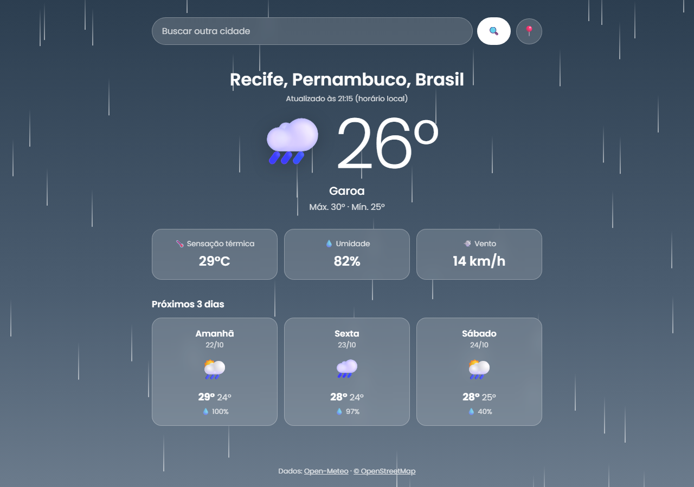

# App de Clima Dinâmico

Aplicativo de previsão do tempo com **geolocalização** e **visual que muda de acordo com o clima**: céu ensolarado, noite estrelada, nuvens, chuva caindo, neve ou tempestade com relâmpagos. Inspirado no widget de clima do Google e no app Climatempo.

**[▶ Ver demo online](https://henrysenaaa.github.io/app-clima/)**

| Tela inicial | Previsão (chuva) |
| --- | --- |
|  |  |

## Funcionalidades

- **Entrada**: digite o nome de uma cidade (com **sugestões** enquanto digita) ou use o botão **"Usar minha localização"** (Geolocation API do navegador).
- **Exibição**: temperatura atual em destaque, condição do tempo, máxima/mínima, **sensação térmica**, **umidade**, vento e **previsão para os próximos 3 dias** com chance de chuva.
- **Visual dinâmico**: o fundo (gradiente + partículas animadas) e os ícones mudam via JavaScript conforme a condição retornada:
  - `Clear` → céu azul com sol (ou noite estrelada)
  - `Clouds` → nuvens passando
  - `Rain` / `Drizzle` → céu cinza com chuva caindo
  - `Thunderstorm` → tempestade com relâmpagos
  - `Snow` → flocos de neve · `Fog` → neblina
- Lembra a última cidade consultada.
- Mensagens de erro para cidade não encontrada, falha de rede e permissão de localização negada.

## Tecnologias e conceitos

- HTML5, CSS3 (glassmorphism, animações) e **JavaScript puro**
- `fetch` encadeando APIs (geocodificação → previsão), com proteção contra respostas fora de ordem
- Geolocation API
- APIs gratuitas e **sem chave**, então nenhuma chave secreta fica exposta no repositório:
  - [Open-Meteo](https://open-meteo.com): previsão e busca de cidades. Os códigos de tempo WMO são convertidos nas categorias `Clear`, `Clouds`, `Rain`... da OpenWeatherMap
  - [Nominatim / OpenStreetMap](https://nominatim.org): nome da cidade a partir das coordenadas

## Estrutura

```
├── index.html
├── style.css
├── js/
│   ├── logic.js   # funções puras: URLs, códigos WMO → tema/ícone, parsing
│   └── app.js     # interface: busca, geolocalização, renderização, temas
└── tests/         # testes automatizados (node:test + jsdom)
```

## Como rodar

Basta abrir o `index.html` no navegador. Para usar a geolocalização, alguns navegadores exigem HTTPS (funciona na demo do GitHub Pages).

## Testes

```bash
npm install
npm test
```

São 19 testes, usando respostas reais das APIs salvas em `tests/fixtures`. Cobrem a troca de tema para cada condição, a geolocalização simulada, as sugestões e os erros.

## Licença

MIT
